# culturals
 非物质文化遗产数字化传承与交流平台  

所有源码均本人开发，项目是前后端分离的，所有的项目都具备了完整的业务逻辑，不仅仅局限于基础的增删改查（CRUD）操作，系统亮点众多。

本文注重于计算机毕业设计选题指导，列出题目均有源码， 大家可以去【公众号】(毕业终点站)获取或者加我【qq】(2112698948)提意见(别忘记Star哟)。备注：git

声明：仅用于学习使用，请勿用于任何商业行为！

1.系统非商用，非开源，非无偿。

2.由本人开发，如需源码，请联系以下方式，qq:2112698948。

3.项目有很多，并未全部上传，如果未找到想要的，可直接咨询。

# 非物质文化遗产数字化传承与交流平台

> 一个把非遗文化搬上线的平台：用户能看非遗项目、读文章、看视频、逛地图、参加研学、买周边、聊话题；传承人发内容带活动、审报名；商企上架周边管订单；管理员统管内容、用户与运营。下面是按「每个亮点都有落点、四个角色都有代表图」精选的核心页面（共 12 张，更多截图可联系补充）。

## 一、技术选型

| 层级 | 技术栈 |
| --- | --- |
| 前端 | Vue、Vue CLI、Element UI、Vue Router、Vuex、Axios、ECharts 5 |
| 后端 | Java、Spring Boot 3.1.1、Spring MVC、MyBatis-Plus、MySQL、JWT、Apache POI |
| 架构 | B/S、MVC、前后端分离；网页前台 + 管理后台，管理员/普通用户/商企/传承人四角色菜单管理 |
| 环境 | Windows、IDEA、JDK17、Maven、MySQL、Node.js |

## 二、系统亮点

1. **协同过滤个性化推荐**：基于用户文章阅读记录，用余弦相似度找兴趣相近的用户，在文化文章详情页左侧推荐未读文章；阅读记录不足时用热门文章补足，帮用户发现感兴趣的非遗内容。
2. **非遗地图探索**：基于非遗项目汇总省份分布，点击省份联动查看非遗类别与传承人统计，直观了解各地非遗资源。
3. **多维文化展示**：把非遗项目、传承人物、文化文章和视频展览集中呈现，让用户从项目背景、人物故事到影像内容多维度了解非遗。
4. **四角色协作**：为管理员、普通用户、商企与传承人配置对应菜单，覆盖平台维护、文化传播、活动参与和周边经营等场景。
5. **研学活动全流程**：支持活动发布、用户报名、后台审核、审核结果查询与精彩瞬间展示，衔接活动组织和用户参与。
6. **文化周边交易**：串联商品浏览、购物车、收货地址、订单结算与订单评价，方便用户选购和反馈非遗周边。
7. **话题互动交流**：支持话题发布、后台审核与评论互动，让用户围绕非遗文化分享见闻、交流体验。
8. **ECharts 数据可视化**：通过非遗地图展示资源分布，后台提供近 30 天新增用户趋势，便于查看平台内容与用户增长。

## 三、角色与功能

- **管理员**：用户与地址管理、文化内容（文章/项目/传承人/视频）管理、研学活动与周边交易管理、话题审核、平台运营（轮播/公告/趋势）。
- **普通用户**：非遗资源探索与地图、文化内容学习、话题互动、研学报名、周边选购与订单管理。
- **商企**：周边商品与分类维护、订单管理、研学活动维护、公告维护。
- **传承人**：文化文章维护、研学活动维护与报名审核、公告维护。

## 四、系统截图

### 普通用户端

<table>
  <tr>
    <td width="50%">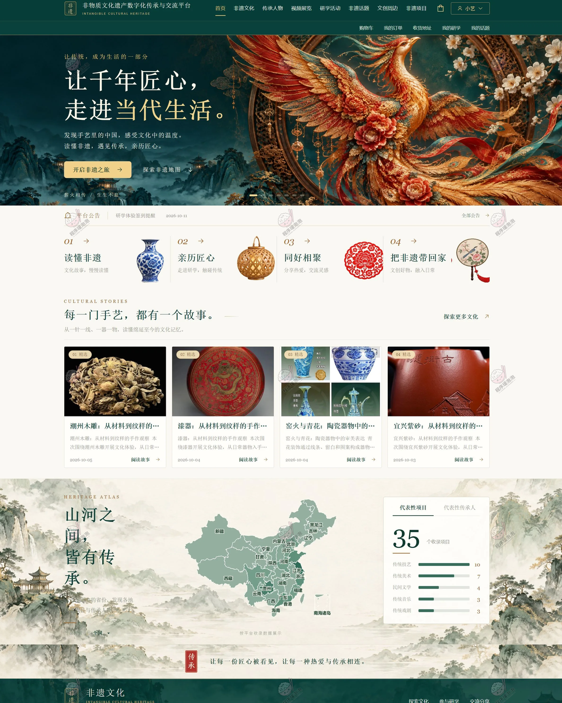</td>
    <td width="50%">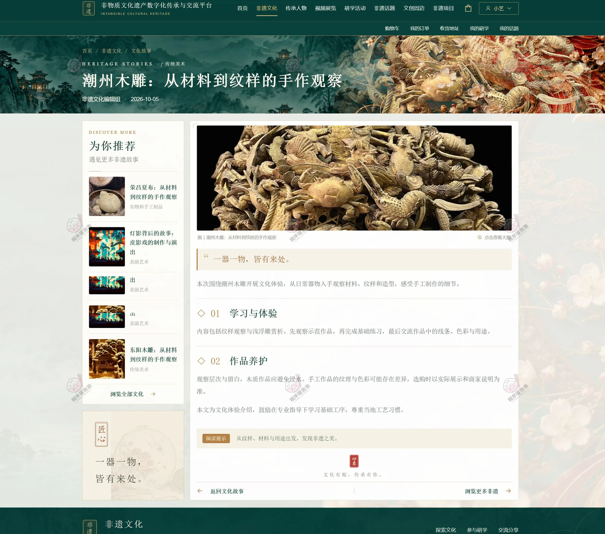</td>
  </tr>
  <tr>
    <td align="center"><b>用户首页</b></td>
    <td align="center"><b>非遗文化详情（左侧个性化推荐）</b></td>
  </tr>
  <tr>
    <td width="50%">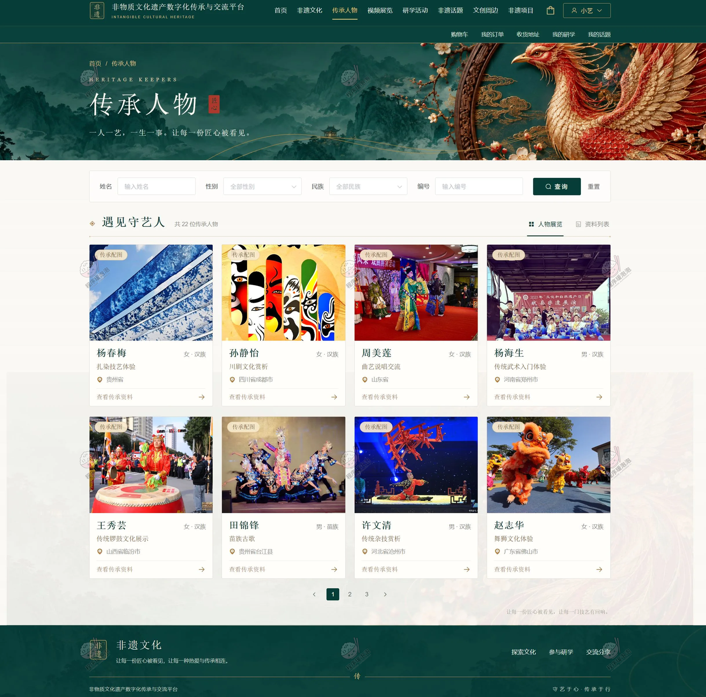</td>
    <td width="50%">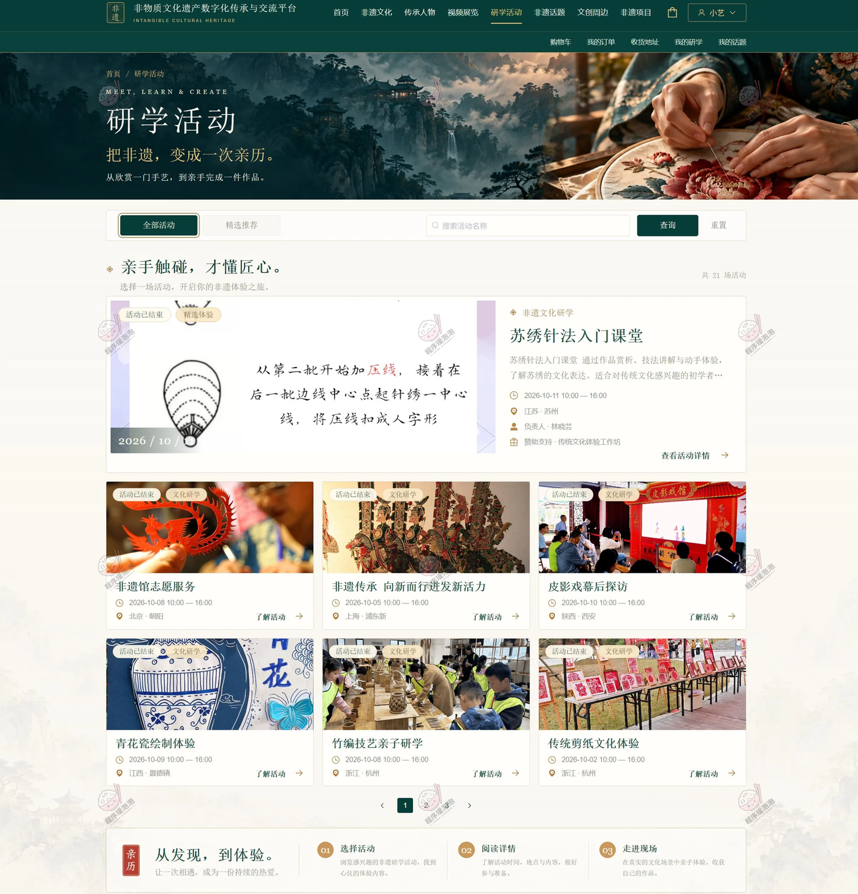</td>
  </tr>
  <tr>
    <td align="center"><b>传承人物</b></td>
    <td align="center"><b>研学活动（报名 / 精彩瞬间）</b></td>
  </tr>
  <tr>
    <td width="50%">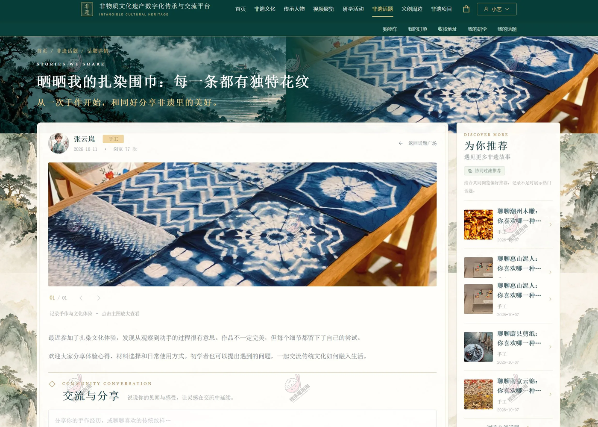</td>
    <td width="50%">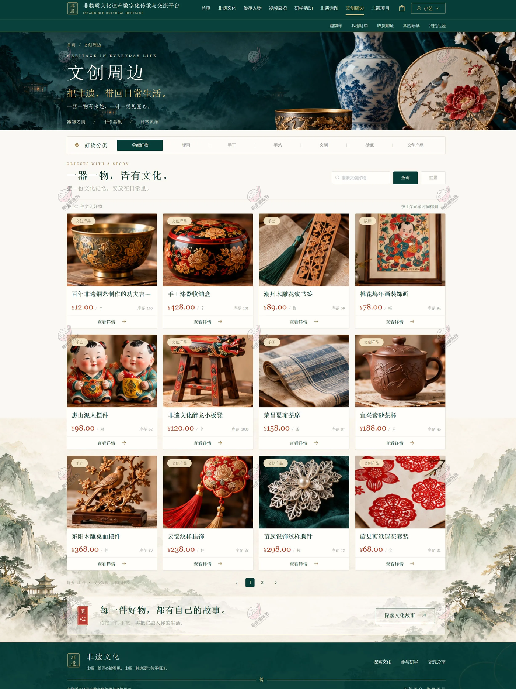</td>
  </tr>
  <tr>
    <td align="center"><b>话题详情（评论互动）</b></td>
    <td align="center"><b>文创周边（商品浏览）</b></td>
  </tr>
  <tr>
    <td width="50%">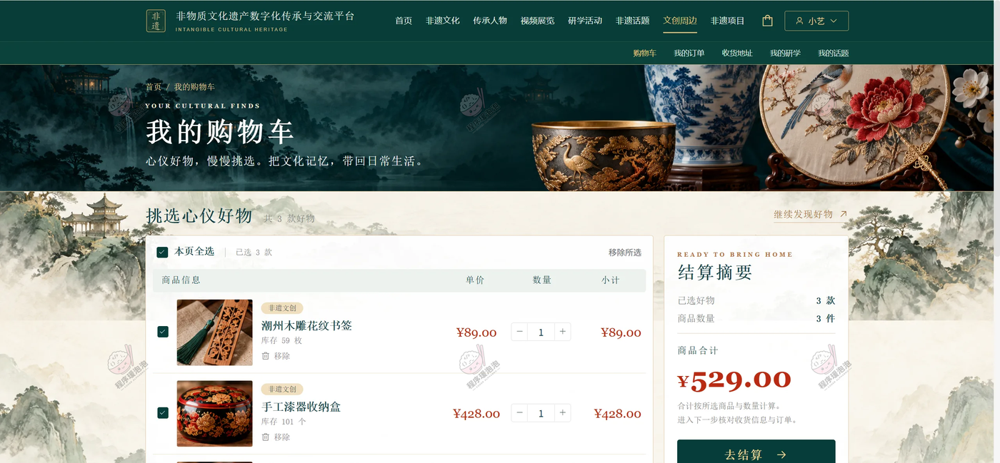</td>
    <td width="50%">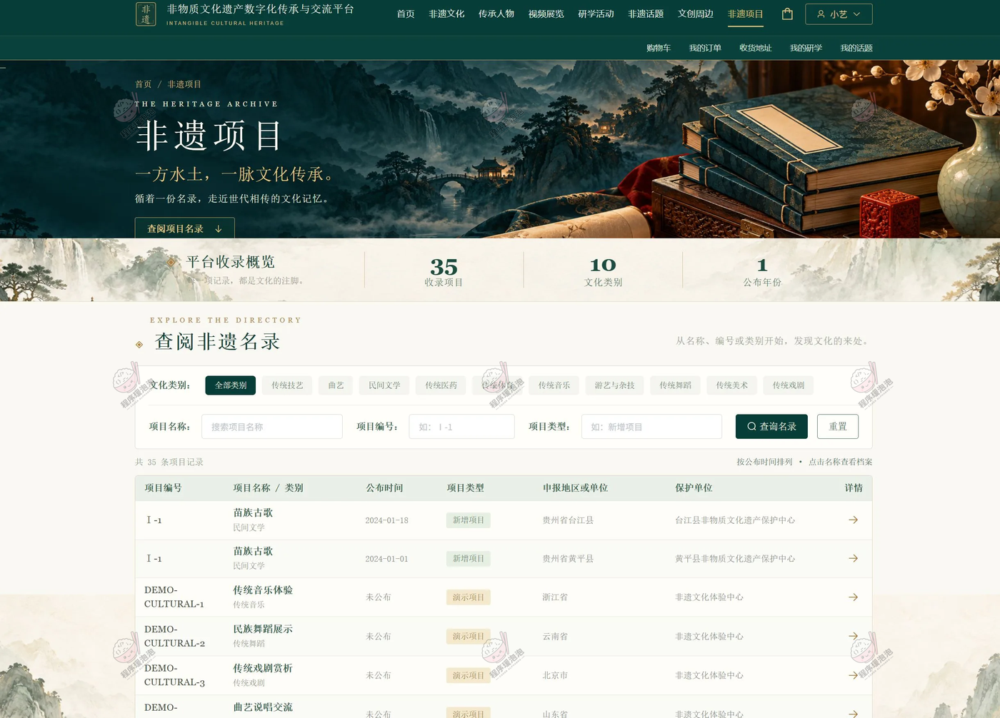</td>
  </tr>
  <tr>
    <td align="center"><b>购物车</b></td>
    <td align="center"><b>非遗项目（地图探索 / ECharts）</b></td>
  </tr>
</table>

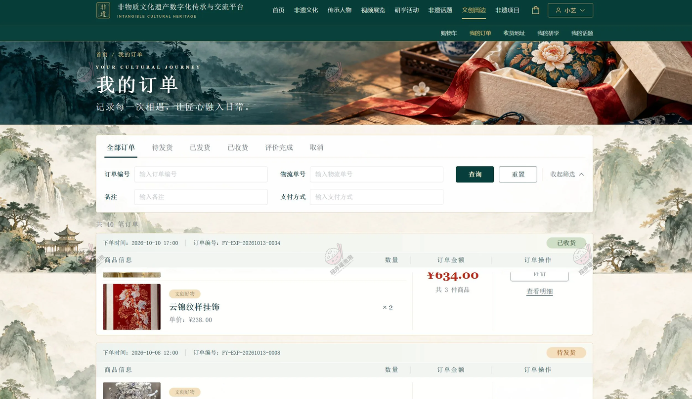

**我的订单** — 查询订单、填写评价、维护收货地址，串起周边交易最后一环。

### 传承人端

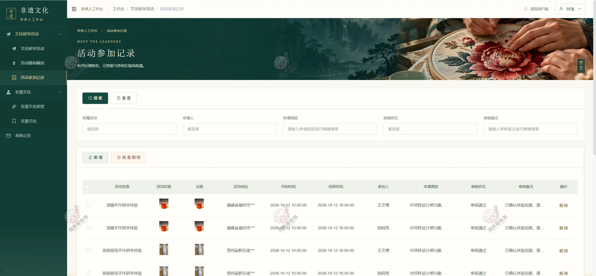

**活动参与记录** — 传承人查询活动参加记录，处理报名申请并填写审核备注，是研学活动全流程的审核落点。

### 商企端

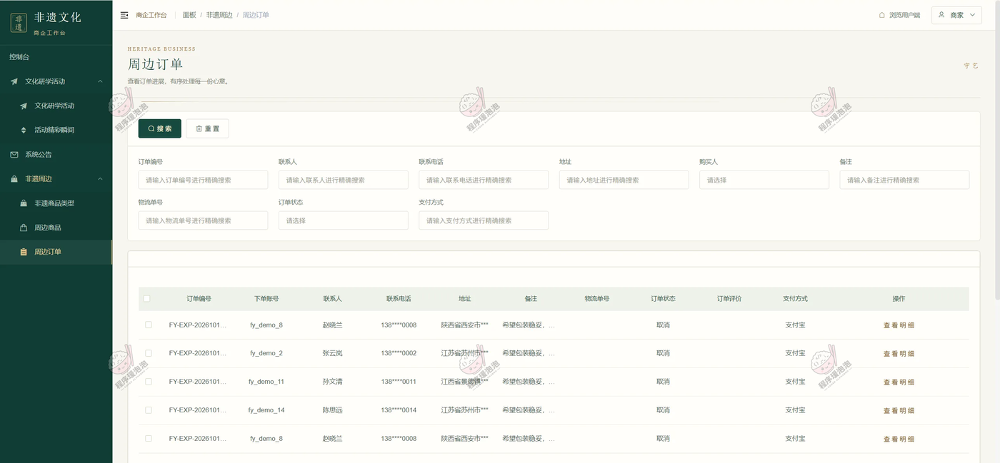

**周边订单** — 商企查询和维护订单信息、查看用户订单评价，对应文化周边交易的管理侧。

### 管理员端

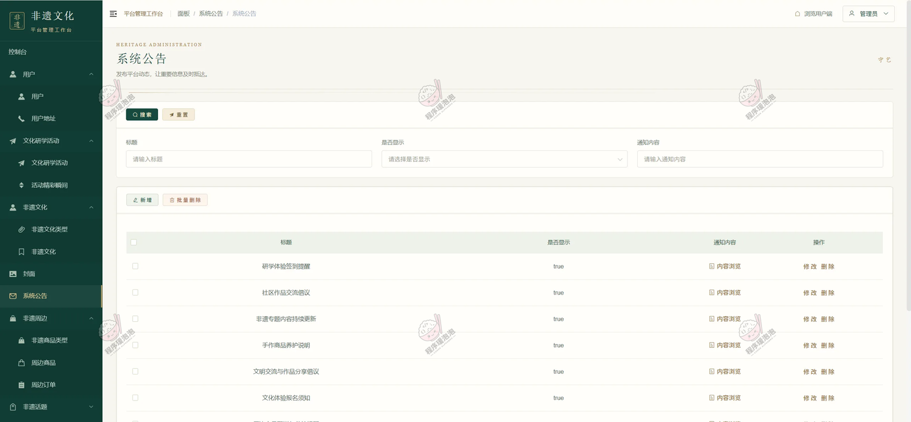

**系统公告与运营趋势** — 维护首页轮播与系统公告，查看近 30 天新增用户趋势（ECharts 数据可视化）。

## 五、结语

文档展示 12 张截图，需要了解更多，请联系我。
